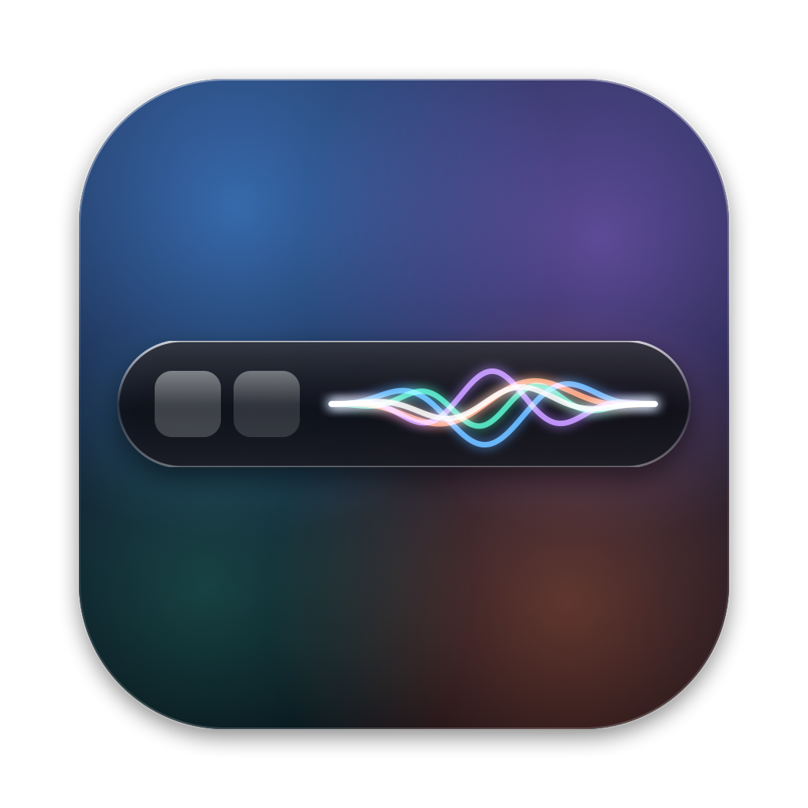
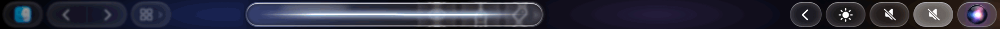
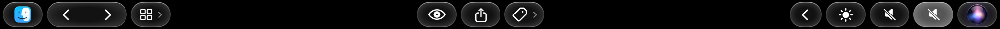
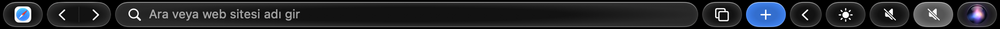
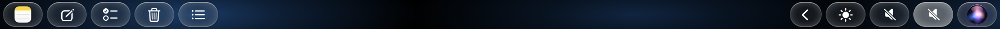
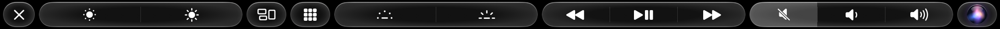
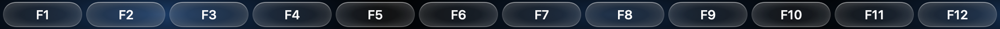
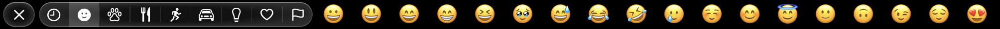

<p align="center"></p>

# GlassBar

> **A personal note**
> GlassBar is the result of about four months of work, and I've been using it every day on my own MacBook for the past two months. It took much longer than I expected, and it still needs more time: some features are missing or only partly working. If you run into any of them, I'd really appreciate it if you let me know.
>
> I'm not fully happy with the design yet either, and I'll keep improving it.
>
> I haven't been able to measure any direct impact on battery life; in my use, CPU usage stays around 1%.
>
> — Yüksel Özge

A native macOS replacement for the Touch Bar on the 13" M2 MacBook Pro. The layout and features match the original (esc · app area · Control Strip, expanded Control Strip, brightness/volume sliders, F1–F12 with fn), redrawn with a Liquid Glass look. Siri appears as a clear glass drop with colorful waves, inspired by Apple's new Siri design.

## Screenshots

**Siri**: a glass drop with colorful waves that react to your voice

<p align="center"></p>



**Finder**


**Safari**


**Notes**


**Expanded Control Strip**


**Brightness and volume**


**fn → F1–F12**


**Emoji**


**Hardware detection** (`Sistem.swift` → `Donanim`): the model is read from `hw.model`. On Touch Bar MacBook Pros from late 2019 onward (MacBookPro16,x, 17,1, Mac14,7), esc is a physical key, the bar is 1004 pt wide, and no esc is shown on the bar. On earlier models the bar is 1085 pt and esc lives on the bar. The "esc on the bar" menu option overrides this. The physical esc key also closes the Siri pill and the sliders.

## Installation
Requires macOS 14 or later and a Touch Bar MacBook Pro.
```
./build.sh --ac
```
This builds the app, installs it as `~/Applications/GlassBar.app` and launches it. A ✨ icon appears in the menu bar (show, the app's own Touch Bar, launch at login, quit).

**Accessibility permission is required** (System Settings → Privacy & Security → Accessibility → GlassBar) to detect esc, F1–F12, shortcuts, media keys, typing suggestions and fn. If a code-signing certificate named "TouchBar2 Yerel Imza" exists in your keychain, `build.sh` signs the app with it, so the permission survives rebuilds. Without it the app is signed ad hoc, and you have to grant the permission again after every build. The permission status at launch is written to `~/Library/Logs/GlassBar.log`. Automation permission is requested on first use for Music, Safari, Photos and Finder tags; the Siri waves ask for microphone access.

## How it works
- To cover the Touch Bar in system-modal mode, GlassBar uses the same private APIs as MTMR and Pock (`NSTouchBar presentSystemModalTouchBar…`, DFRFoundation). It may break if Apple changes them.
- The app icon button (next to esc) shrinks GlassBar and shows the front app's own Touch Bar items (typing suggestions, etc.). The ✨ button in the Control Strip, or switching to another app, brings GlassBar back.
- Brightness: DisplayServices; keyboard backlight: CoreBrightness; volume: CoreAudio. Step buttons send media keys so the system HUD appears.
- Since macOS 26, the Launchpad button opens "Apps".
- The Siri button opens the real Siri. The waves in the glass drop follow the microphone level (background noise is filtered out). The pill closes after 12 seconds, on tap, with esc, or when you switch apps.

## Menu (✨)
What the Touch Bar shows, and what it shows while fn is held (app controls, expanded Control Strip, F keys, desktop spaces); show the Control Strip; Control Strip buttons; typing suggestions; esc on the bar; theme (Classic / Simple Liquid Glass); background (app color, styles, wallpaper, custom image, or off); and, for the front app, "show its own Touch Bar" / "always F keys".

Switching between desktop spaces uses the ⌃1…⌃9 shortcuts, so the "Switch to Desktop N" shortcuts must be enabled in System Settings → Keyboard → Keyboard Shortcuts → Mission Control. Suggestions and emoji need the Accessibility permission; Spotify asks for Automation permission on first use.

Full feature list: [FEATURES.md](FEATURES.md) (Turkish: [OZELLIKLER.md](OZELLIKLER.md)).

## Files
`Sources/main.swift` (private API, menu), `Durum.swift` (state and button actions), `Cubuk.swift` (layout and app-specific buttons: Safari, Notes, Music, Finder…), `Cam.swift` (glass button, group, slider), `Siri.swift` (Siri glass drop and waves), `Mikrofon.swift` (microphone level), `Sistem.swift` (system calls), `Ayarlar.swift` (settings, Control Strip buttons, Night Shift, input source, spaces), `Calan.swift` (Now Playing, video filmstrips), `Yazi.swift` (suggestions, emoji, scrolling strip), `ArkaPlan.swift` (background styles).

The code and comments are in Turkish. The interface follows the system language (English and Turkish; other languages fall back to English).

## Liquid glass touch (`Cam.swift` → `SiviBasma`)
When you touch a button, it grows by 10%, light appears under your finger, a ring of light spreads out from there, the edge glows, and the ambient light behind the glass lights up at that spot. As your finger slides, the button stretches in that direction; when you let go, it springs back into place. In grouped buttons a glass drop swells up inside the group, and a slider's knob turns into a clear lens while you drag it. The action runs when you lift your finger while it is still on the button.

Screenshot testing: `open ~/Applications/GlassBar.app --args -tb2kip genis|parlaklik|ses|siri|siriDemo|fn|emoji|simdi` (add `-tb2basili YES` for the pressed look), then `screencapture -b bar.png`. `siriDemo` animates Siri without the microphone.

**Coming soon:** Spotify integration: sign in to browse playlists, search, Add to Queue and pick Spotify Connect devices from the Touch Bar.

---

Made by **Yüksel Özge** · [github.com/Moryel/glass-bar](https://github.com/Moryel/glass-bar)
