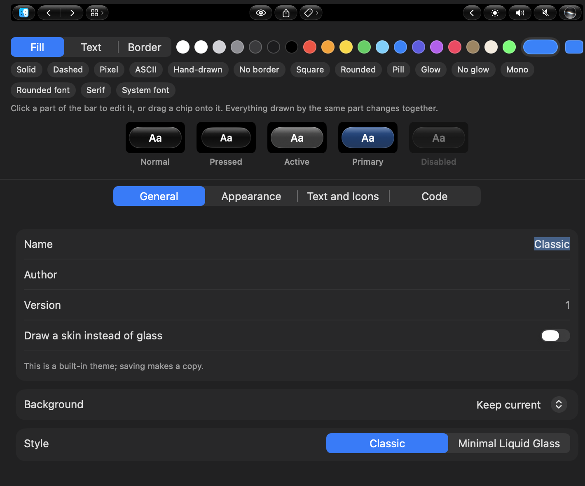
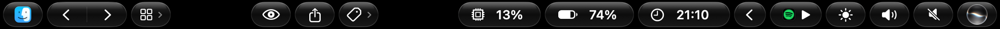
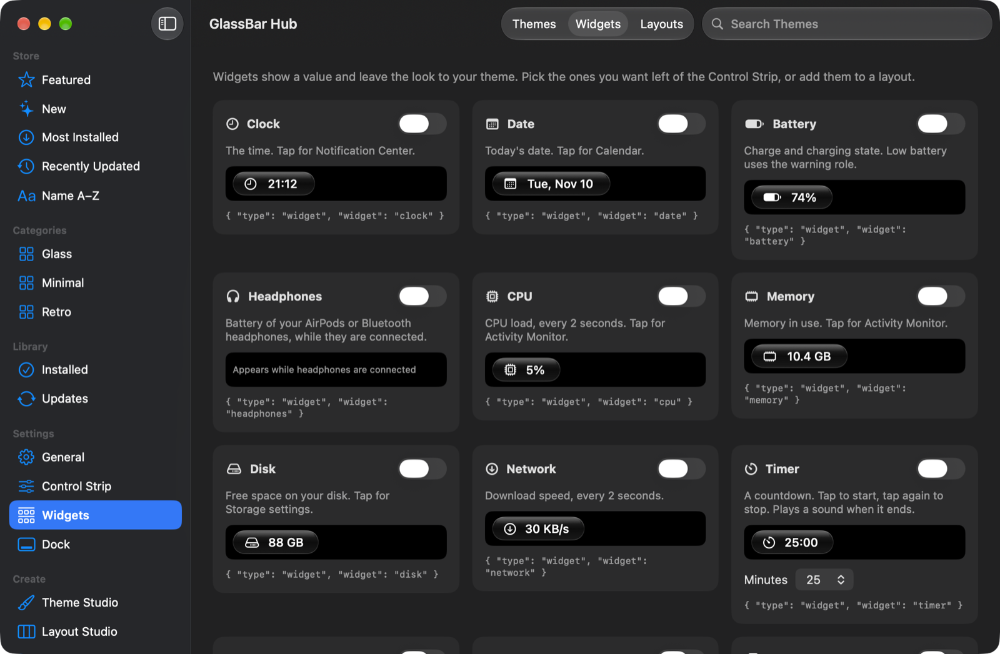
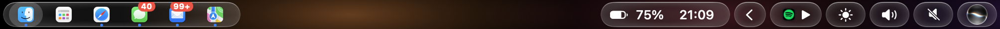
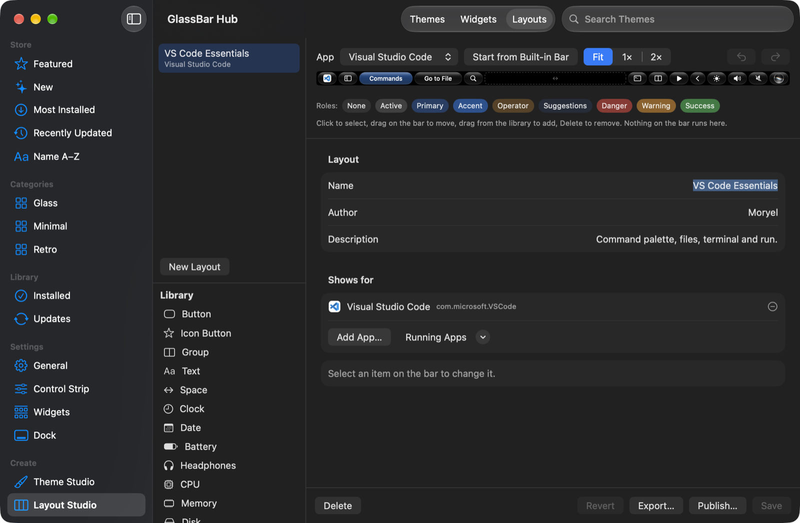

<p align="center"></p>

# GlassBar

A free, open-source replacement for the Touch Bar on MacBook Pros from 2018 on (macOS 14 or later). It keeps the original layout (esc, app buttons, Control Strip) and redraws it with a Liquid Glass look. You can also change the whole look with themes, draw your own in Theme Studio, add widgets and a Dock, give any app your own buttons, and share all of it through a small store inside the app.


[Download](#download) · [Themes](#themes) · [Widgets and the Dock](#widgets-and-the-dock) · [Layouts](#layouts) · [Hub](#glassbar-hub) · [Security](#security) · [Build](#build-from-source)

**New in 2.1:** Theme Studio, Layout Studio, widgets you can write yourself, the Dock, and the Original theme. [Release notes](https://github.com/Moryel/glass-bar/releases/latest)

## Download

**[⬇ Download GlassBar.zip](https://github.com/Moryel/glass-bar/releases/latest/download/GlassBar.zip)** · Intel and Apple Silicon · macOS 14 Sonoma or later · MacBook Pro with a Touch Bar, 2018 or later (2016 and 2017 models can't run macOS 14)

1. Unzip it and drag **GlassBar.app** into **Applications**.
2. Open it. GlassBar is free and not notarized by Apple, so the first time macOS blocks it:
   - **macOS 15 and later:** System Settings > Privacy & Security > scroll down > **Open Anyway**.
   - **macOS 14:** right-click GlassBar.app > **Open** > **Open**.

   Or, in Terminal: `xattr -dr com.apple.quarantine /Applications/GlassBar.app`
3. Give GlassBar **Accessibility** permission when asked (see [Permissions](#permissions)).
4. A GlassBar icon appears in the menu bar. Turn on **Launch at Login** there to have it start with your Mac.

GlassBar checks for updates itself and tells you when a new version is out.

## Themes

Seven themes are built in. Classic, Minimal Liquid Glass, Graphite and Neon keep the glass look. Terminal and 8-Bit Arcade draw the bar their own way, with their own font, borders, icons and an optional tap sound. Original hands the bar back to macOS: you get Apple's own Touch Bar, with your first widget sitting in the Control Strip. Tap it and the rest slide in over the app area, left, centered or right, while Apple's controls stay where they are.


**Theme Studio** (in the Hub) makes a theme without writing anything. Start from a dark, light, outline, pixel or terminal starter, click a part on the preview bar and change its fill, text, border and shape. Quick Colors recolors the whole theme at once, the bar background takes any color, gradient, pattern or image, and the Code tab shows the same theme as JSON if you'd rather type. What you change shows on your Touch Bar right away.



A theme is a JSON file underneath. To write one by hand, choose Theme > Open Themes Folder from the menu, add a `theme.json`, and use Theme > Reload Themes and Layouts after each save. Every field is described in [docs/THEMES.md](docs/THEMES.md). Bad values are skipped and written to `~/Library/Logs/GlassBar.log` instead of breaking the bar. The format is still alpha and may change.

Made a theme you like? Send it with a pull request and it shows up in the store for everyone, see [themes/README.md](themes/README.md). Themes can also be shared as `.glasstheme` packages, which install with a double-click.

## Widgets and the Dock

Widgets sit left of the Control Strip or inside a layout: clock, date, battery, headphones battery, CPU, memory, disk, network speed, timer, Focus, world clock, clipboard and now playing. The battery follows the charger the moment you plug it in or pull it, and its icon turns yellow in Low Power Mode. A widget only gives a value and the theme draws it, so the same battery is a glass capsule in Classic and `[bat 87%]` in Terminal.



Script widgets are small JavaScript files ([docs/WIDGETS.md](docs/WIDGETS.md)). They run without a browser, only while they are on the bar, and can use the network, open links or press shortcuts only if they ask for it. You see that list before installing. **Add Weather** in the Widgets page makes one for you to start from.



The **Dock** puts your macOS Dock on the Touch Bar, with running dots, badges, a menu on long press and drag to reorder. An app bounces while it opens, the app in front scrolls into view, the Trash shows whether it's full, and the battery and clock can sit at the end.



## Layouts

A layout gives one app your own Touch Bar buttons: keyboard shortcuts, menu commands, web links, or opening another app. **Layout Studio** edits them on the real bar by dragging, and can start from one of the built-in bars. Pick the app, drag buttons, groups, spaces and widgets from the library, and choose what each one does. Xcode, VS Code, Terminal and Figma layouts are in the store to start with.




Layouts are JSON too. How to write one is in [docs/LAYOUTS.md](docs/LAYOUTS.md), and they're shared the same way as themes ([layouts/README.md](layouts/README.md)).

## GlassBar Hub

Menu > **GlassBar Hub…** opens the store and your library. It has a featured pick, new and most installed themes, categories and search. One click installs a theme and puts it on the bar, and a theme's page shows it on Finder, Safari, Mail and other bars before you get it. The store is just the [themes](themes) and [layouts](layouts) folders of this repo, so there's no account or server.


Your installed themes and layouts are under Library, with updates when an author changes theirs.


Settings live in the Hub too, so the menu bar menu stays short. **Publish…** on your own theme, layout or widget checks it, lists every file that would become public and opens the pull request page for you. The Hub window was built with AI assistance so I could spend more time on the theme engine and performance.

## What it does

- **App bars.** Safari, Finder, Mail, Notes, Messages, Calculator, Calendar, Contacts, Preview, Photos, TextEdit, Reminders and the ⇧⌘5 screenshot tool get bars that follow the originals. For any other app, press and hold the app icon on the left to see the app's own Touch Bar.
- **Control Strip.** Collapsed and expanded, like the original. You can pick up to five of 19 buttons, such as Spotlight, Night Shift, Screenshot or Lock Screen.
- **Brightness and volume sliders.** Touch the button and slide without lifting, as on the original.
- **fn keys.** Hold fn for F1 to F12, the expanded Control Strip, app controls or desktop spaces. Some apps can always show F keys.
- **Siri.** A clear glass drop with colorful waves that follow your voice.
- **Now Playing and Spotify.** Play controls and scrubbing for Music, Spotify and QuickTime. Spotify shows the album cover and a sound bar in its colors.
- **Typing suggestions and emoji.** Word suggestions while you type, and the nine emoji categories with momentum scrolling.
- **Backgrounds.** The app's color, a few color styles, your wallpaper or your own image behind the glass.
- **esc.** On Macs with a physical esc key (late 2019 and later) the bar is shorter and has no esc. Older models get esc on the bar.

The full list, with what's still missing compared to Apple's Touch Bar, is in [FEATURES.md](FEATURES.md) (Turkish: [FEATURES.tr.md](FEATURES.tr.md)).

## Screenshots

**Siri**

<p align="center"></p>

**Safari**


**Notes**


**Expanded Control Strip**


**Brightness and volume**


**fn: F1 to F12**


**Emoji**


## Performance

GlassBar only redraws the bar when something on it changes, so it sits at about 1% CPU or less and under 80 MB of memory. The moving background styles used to keep the system's Touch Bar process busy; they now come to rest 20 seconds after the last change, and cost nothing after that. Widgets read their values only while they are on the bar.

## Permissions

**Accessibility** is required (System Settings > Privacy & Security > Accessibility > GlassBar). GlassBar uses it for esc, F1 to F12, shortcuts, media keys, typing suggestions, fn and menu commands. The permission status at launch is written to `~/Library/Logs/GlassBar.log`.

Other permissions are asked for only when a feature needs them: Automation for Music, Spotify, Safari, Photos and Finder tags, the microphone for the Siri waves, and system audio recording for the Spotify sound bar (only the level is measured, nothing is recorded). The Focus widget can only tell whether a Focus is on with Full Disk Access; without it the widget just opens Focus settings.

Switching desktop spaces uses ⌃1 to ⌃9, so turn on "Switch to Desktop N" in System Settings > Keyboard > Keyboard Shortcuts > Mission Control.

## Security

Themes, layouts and widgets come from other people, so GlassBar treats them as untrusted.

- **Themes and layouts are data.** They can't run code. A layout can press keys and menu items, open http and https links and open apps, nothing else.
- **Files stay in their package.** A theme or layout can only use fonts, images and sounds inside its own folder. Paths with `../`, symlinks that lead elsewhere and ids that aren't plain folder names are refused, both on install and on every read.
- **Script widgets run in a sandbox.** Plain JavaScript without a browser, no file access, no shell, no AppleScript. Each call gets half a second. Network, links and shortcuts each need a permission you see before installing.
- **Widget network access is public https only.** No localhost, no IP addresses, no home network names, no ports, and a redirect to any of those is stopped. A name that points at a private address (127.0.0.1, 192.168.x.x and the like) is refused too, and the address that really answered is checked again. No cookies.
- **Publishing shows you everything first.** Hidden files and symlinks never go into a package.
- **Updates are never installed for you.** GlassBar only tells you a new version is out and opens its GitHub page.

Found a hole? Please open an issue, or write to me first if it's a serious one.

## A personal note

GlassBar is the result of about four months of work, and I've been using it every day on my own MacBook for the past two months. It took much longer than I expected, and it still needs more time: some features are missing or only partly working. If you run into any of them, I'd really appreciate it if you let me know.

I'm not fully happy with the design yet either, and I'll keep improving it.

I haven't been able to measure any direct impact on battery life; in my use, CPU usage stays around 1%.

Yüksel Özge

## How it works

- GlassBar covers the Touch Bar using the same private APIs as MTMR and Pock (`NSTouchBar presentSystemModalTouchBar…`, DFRFoundation). It may break if Apple changes them.
- Brightness uses DisplayServices, keyboard backlight CoreBrightness, volume CoreAudio. The step buttons send media keys so the system HUD appears.
- App buttons press the app's own menu items through Accessibility, so they work in English and Turkish and with any keyboard layout.
- The interface follows the system language (English and Turkish, other languages fall back to English). Turkish strings are in `Resources/tr.lproj/Localizable.strings`.

## Build from source

Requires the Xcode command line tools.

```
./build.sh --ac      # builds, installs to ~/Applications and opens it
./build.sh release   # universal build and build/GlassBar.zip
```

If a code-signing certificate named "TouchBar2 Yerel Imza" is in your keychain, `build.sh` signs with it so the Accessibility permission survives rebuilds. Without it the app is signed ad hoc, and you have to grant the permission again after every build.

For screenshots: `open ~/Applications/GlassBar.app --args -testPanel expanded|brightness|volume|siri|siriDemo|fn|emoji|nowPlaying|stripEditor|tabs|hub|store|layouts` (add `-testPressed YES` for the pressed look), then `screencapture -b bar.png`.

The code is in `Sources/`: `main.swift` (app delegate and menu), `TouchBarView.swift` (the bar and the app bars), `Glass.swift` (buttons, groups, sliders), `Theme.swift` and `Skin.swift` (themes), `Layout.swift` (layouts), `Hub.swift` (Hub and store), `ThemeStudio.swift`, `LayoutEditor.swift`, `Widgets.swift`, `ScriptWidgets.swift`, `Dock.swift`, `Publish.swift`, `Siri.swift`, `NowPlaying.swift`, `SpotifyPlayer.swift`, `Suggestions.swift`, `SystemControl.swift` and a few smaller files.

## Roadmap

2.1 brought Theme Studio, widgets and script widgets, Layout Studio, the Dock, the Original theme and publishing from the app. Bundles (a theme with its own layouts and widgets) and more widgets come next. Spotify sign-in with playlists, search and device picking is planned too. Everything is in [ROADMAP.md](ROADMAP.md).

---

Made by **Yüksel Özge** · [github.com/Moryel/glass-bar](https://github.com/Moryel/glass-bar)
