<p align="center">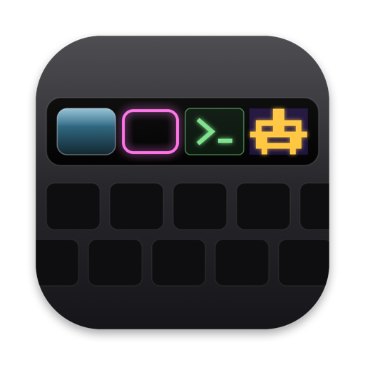</p>

# GlassBar

A free, open-source replacement for the Touch Bar on MacBook Pros from 2018 on (macOS 14 or later). It keeps the original layout (esc, app buttons, Control Strip) and redraws it with a Liquid Glass look. You can also change the whole look with themes, give any app your own buttons, and get both from a small store inside the app.

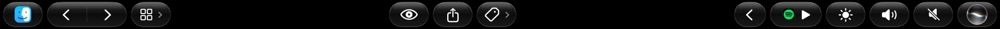

> **A personal note**
> GlassBar is the result of about four months of work, and I've been using it every day on my own MacBook for the past two months. It took much longer than I expected, and it still needs more time: some features are missing or only partly working. If you run into any of them, I'd really appreciate it if you let me know.
>
> I'm not fully happy with the design yet either, and I'll keep improving it.
>
> I haven't been able to measure any direct impact on battery life; in my use, CPU usage stays around 1%.
>
> Yüksel Özge

## Download

**[⬇ Download GlassBar.zip](https://github.com/Moryel/glass-bar/releases/latest/download/GlassBar.zip)** · Intel and Apple Silicon · macOS 14 Sonoma or later · MacBook Pro with a Touch Bar, 2018 or later (2016 and 2017 models can't run macOS 14)

1. Unzip it and drag **GlassBar.app** into **Applications**.
2. Open it. GlassBar is free and not notarized by Apple, so the first time macOS blocks it:
   - **macOS 15 and later:** System Settings > Privacy & Security > scroll down > **Open Anyway**.
   - **macOS 14:** right-click GlassBar.app > **Open** > **Open**.

   Or, in Terminal: `xattr -dr com.apple.quarantine /Applications/GlassBar.app`
3. Give GlassBar **Accessibility** permission when asked (see [Permissions](#permissions)).
4. A GlassBar icon appears in the menu bar. Turn on **Launch at Login** there to have it start with your Mac.

GlassBar checks for updates itself and tells you when a new version is out.

## Themes

Six themes are built in. Classic, Minimal Liquid Glass, Graphite and Neon keep the glass look. Terminal and 8-Bit Arcade draw the bar their own way, with their own font, borders, icons and an optional tap sound.

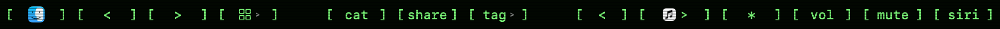
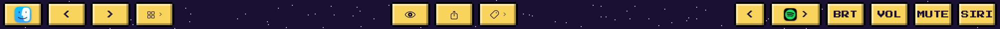

A theme is a JSON file. To write your own, choose Theme > Open Themes Folder from the menu, add a `theme.json`, and use Theme > Reload Themes and Layouts after each save. Every field is described in [docs/THEMES.md](docs/THEMES.md). Bad values are skipped and written to `~/Library/Logs/GlassBar.log` instead of breaking the bar. The format is still alpha and may change.

Made a theme you like? Send it with a pull request and it shows up in the store for everyone, see [themes/README.md](themes/README.md). Themes can also be shared as `.glasstheme` packages, which install with a double-click.

## GlassBar Hub

Menu > **GlassBar Hub…** opens the store and your library. It has a featured pick, new and most installed themes, categories and search. One click installs a theme and puts it on the bar. The store is just the [themes](themes) and [layouts](layouts) folders of this repo, so there's no account or server.

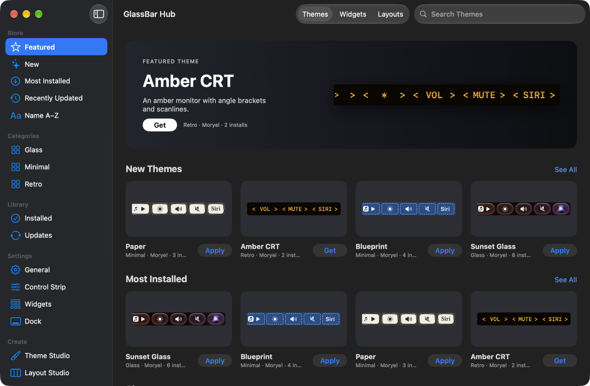

Your installed themes and layouts are under Library, with updates when an author changes theirs.

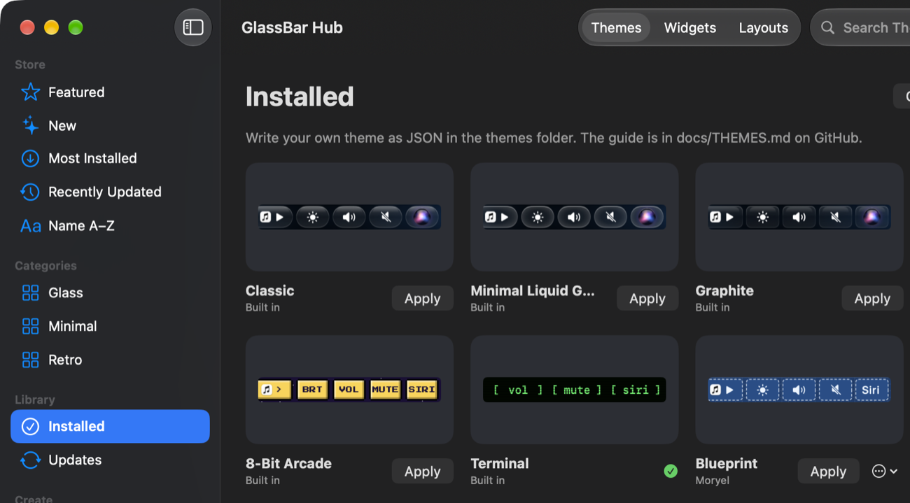

Widgets, Theme Studio (a visual theme editor) and a layout editor already show up in the Hub but are still in development. The Hub window was built with AI assistance so I could spend more time on the theme engine and performance.

## Layouts

A layout gives one app your own Touch Bar buttons: keyboard shortcuts, menu commands, links, or opening another app. Xcode, VS Code, Terminal and Figma layouts are in the store to start with.

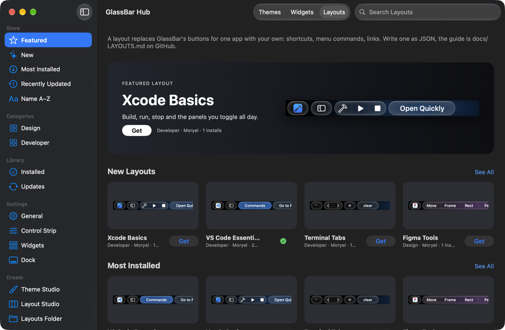

Layouts are JSON too. How to write one is in [docs/LAYOUTS.md](docs/LAYOUTS.md), and they're shared the same way as themes ([layouts/README.md](layouts/README.md)).

## What it does

- **App bars.** Safari, Finder, Mail, Notes, Messages, Calculator, Calendar, Contacts, Preview, Photos, TextEdit, Reminders and the ⇧⌘5 screenshot tool get bars that follow the originals. For any other app, press and hold the app icon on the left to see the app's own Touch Bar.
- **Control Strip.** Collapsed and expanded, like the original. You can pick up to five of 19 buttons, such as Spotlight, Night Shift, Screenshot or Lock Screen.
- **Brightness and volume sliders.** Touch the button and slide without lifting, as on the original.
- **fn keys.** Hold fn for F1 to F12, the expanded Control Strip, app controls or desktop spaces. Some apps can always show F keys.
- **Siri.** A clear glass drop with colorful waves that follow your voice.
- **Now Playing and Spotify.** Play controls and scrubbing for Music, Spotify and QuickTime. Spotify shows the album cover and a sound bar in its colors.
- **Typing suggestions and emoji.** Word suggestions while you type, and the nine emoji categories with momentum scrolling.
- **Backgrounds.** The app's color, a few color styles, your wallpaper or your own image behind the glass.
- **esc.** On Macs with a physical esc key (late 2019 and later) the bar is shorter and has no esc. Older models get esc on the bar.

**Siri**

<p align="center"></p>

**Safari**
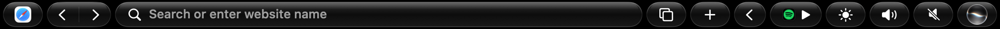

**Notes**
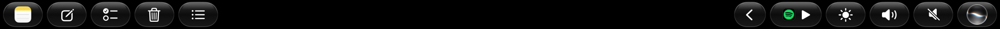

**Expanded Control Strip**
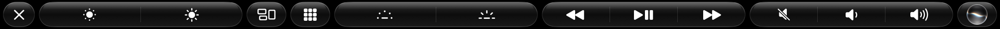

**Brightness and volume**


**fn: F1 to F12**
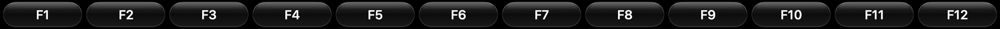

**Emoji**
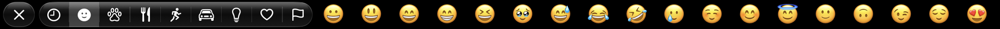

The full list, with what's still missing compared to Apple's Touch Bar, is in [FEATURES.md](FEATURES.md) (Turkish: [FEATURES.tr.md](FEATURES.tr.md)).

## Performance

GlassBar only redraws the bar when something on it changes, so it sits at about 1% CPU or less and around 40 MB of memory. The moving background styles cost a bit more, because the system's Touch Bar process has to draw them. Turn the background off and that cost goes away.

## Permissions

**Accessibility** is required (System Settings > Privacy & Security > Accessibility > GlassBar). GlassBar uses it for esc, F1 to F12, shortcuts, media keys, typing suggestions, fn and menu commands. The permission status at launch is written to `~/Library/Logs/GlassBar.log`.

Other permissions are asked for only when a feature needs them: Automation for Music, Spotify, Safari, Photos and Finder tags, the microphone for the Siri waves, and system audio recording for the Spotify sound bar (only the level is measured, nothing is recorded).

Switching desktop spaces uses ⌃1 to ⌃9, so turn on "Switch to Desktop N" in System Settings > Keyboard > Keyboard Shortcuts > Mission Control.

## How it works

- GlassBar covers the Touch Bar using the same private APIs as MTMR and Pock (`NSTouchBar presentSystemModalTouchBar…`, DFRFoundation). It may break if Apple changes them.
- Brightness uses DisplayServices, keyboard backlight CoreBrightness, volume CoreAudio. The step buttons send media keys so the system HUD appears.
- App buttons press the app's own menu items through Accessibility, so they work in English and Turkish and with any keyboard layout.
- The interface follows the system language (English and Turkish, other languages fall back to English). Turkish strings are in `Resources/tr.lproj/Localizable.strings`.

## Build from source

Requires the Xcode command line tools.

```
./build.sh --ac      # builds, installs to ~/Applications and opens it
./build.sh release   # universal build and build/GlassBar.zip
```

If a code-signing certificate named "TouchBar2 Yerel Imza" is in your keychain, `build.sh` signs with it so the Accessibility permission survives rebuilds. Without it the app is signed ad hoc, and you have to grant the permission again after every build.

For screenshots: `open ~/Applications/GlassBar.app --args -testPanel expanded|brightness|volume|siri|siriDemo|fn|emoji|nowPlaying|stripEditor|tabs|hub|store|layouts` (add `-testPressed YES` for the pressed look), then `screencapture -b bar.png`.

The code is in `Sources/`: `main.swift` (app delegate and menu), `TouchBarView.swift` (the bar and the app bars), `Glass.swift` (buttons, groups, sliders), `Theme.swift` and `Skin.swift` (themes), `Layout.swift` (layouts), `Hub.swift` (Hub and store), `Siri.swift`, `NowPlaying.swift`, `SpotifyPlayer.swift`, `Suggestions.swift`, `SystemControl.swift` and a few smaller files.

## Roadmap

Theme Studio comes next (2.1), then a bigger store, a layout editor and widgets that follow the theme. Spotify sign-in with playlists, search and device picking is planned too. Everything is in [ROADMAP.md](ROADMAP.md).

---

Made by **Yüksel Özge** · [github.com/Moryel/glass-bar](https://github.com/Moryel/glass-bar)
