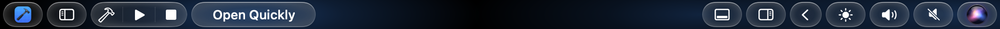
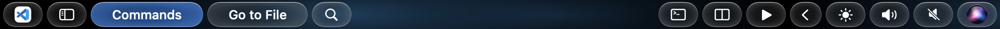
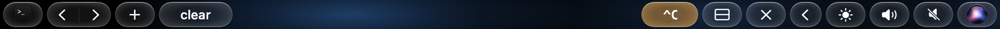
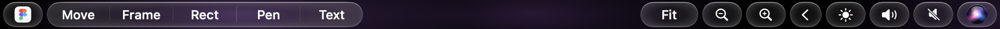

# Community layouts

Layouts made by GlassBar users. Every layout here shows up in the Layouts tab of GlassBar Hub (menu > GlassBar Hub…), where you can install it with one click.

| | |
|---|---|
| **Xcode Basics** by Moryel |  |
| **VS Code Essentials** by Moryel |  |
| **Terminal Tabs** by Moryel |  |
| **Figma Tools** by Moryel |  |

How to write a layout: [docs/LAYOUTS.md](../docs/LAYOUTS.md).

## Submitting a layout

Open a pull request that adds one folder here:

```
layouts/
  my-layout/
    layout.json
    preview.png        (a screenshot of the bar with the app in front)
    icon.png           (only if the layout uses its own images)
```

- The folder name is the layout's `id`. Lowercase letters, numbers and dashes.
- `layout.json` needs `id`, `name`, `author` and `apps`.
- `preview.png` is required. `screencapture -b preview.png` saves the Touch Bar. Use a glass theme (Minimal Liquid Glass) so the previews look alike, and check that nothing private is on the bar.
- Add it to `index.json` in this folder: `id`, `name`, `author`, `version`, a one-line `description`, a `category` (Developer, Design or a new one), `added` and `updated` dates and the list of `files`.
- When you update a layout, raise `version` in both `layout.json` and `index.json`.
- Check `~/Library/Logs/GlassBar.log` after loading it. It should have no lines about your layout.

One layout per pull request please. After a merge, a GitHub workflow zips it into the [layouts release](https://github.com/Moryel/glass-bar/releases/tag/layouts), which is where the store installs it from and how it counts installs.

The layout format is still alpha. I'll try to fix the layouts here myself when it changes.
